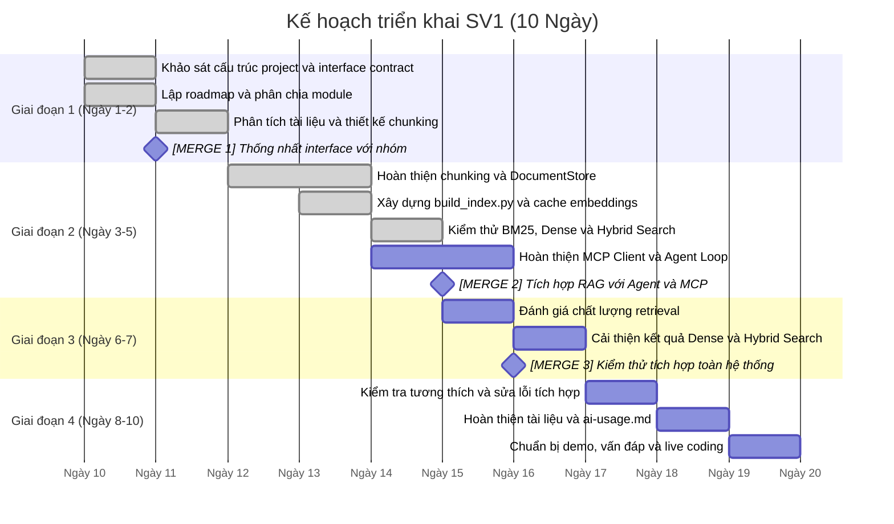

# Lộ Trình & Kế Hoạch Tiến Độ — SV1 (RAG Retrieval + Agent Loop + MCP Client)

> **Môn:** AI Programming with Python (AIPR) — Final Project (10 ngày)  
> **Đề tài:** T4 — Trợ lý Điểm Rèn Luyện & Khiếu Nại  
> **Phân công SV1:** RAG Retrieval (Chunking, Embeddings, DocumentStore, Hybrid Search), Agent Loop, MCP Client và tích hợp tầng tra cứu.

---

## 1. Tổng quan các mốc thời gian (Timeline 10 Ngày)

*Lưu ý: Timeline trên là bản kế hoạch đề xuất theo khung 10 ngày của nhóm; trạng thái Done chỉ áp dụng cho các công việc đã có kết quả triển khai hoặc kiểm thử được xác nhận.*

---

## 2. Chi tiết từng giai đoạn & Điều kiện hoàn thành file

### 🔹 Giai đoạn 1: Khảo sát dự án và thiết kế Retrieval (Ngày 1–2)

| File SV1 sở hữu | Tài liệu mẫu & Code mẫu liên quan | Deadline | Tiêu chí hoàn thành (DoD) | Trạng thái |
|---|---|---|---|---|
| `context/roadmap-sv1.md` | Yêu cầu dự án, phân công SV1 | Ngày 1 | Xác định phạm vi công việc, các module phụ trách, thứ tự triển khai và các mốc merge. | **Hoàn thành (Done)** |
| `rag/models.py` | Cấu trúc dữ liệu Document và DocumentChunk | Ngày 1 | Thống nhất các trường dữ liệu, ID, embedding và metadata để tương thích với chunking và store. | Đã triển khai, cần đối chiếu interface cuối |
| `rag/chunking.py` | Tài liệu Markdown trong `data/source_docs/` | Ngày 2 | Loại bỏ mục lục, nhận diện cấu trúc chương/mục/điều khoản và chia nội dung thành chunks có độ dài phù hợp. | Đã triển khai, đã kiểm thử cơ bản |

🤝 **Điểm Merge & Bàn Giao #1**

- Thống nhất cấu trúc `Document` và `DocumentChunk`.
- Thống nhất định dạng metadata và cách lưu dữ liệu để các module có thể sử dụng chung.

---

### 🔹 Giai đoạn 2: Xây dựng Retrieval Pipeline và Kiểm thử (Ngày 3–5)

| File SV1 sở hữu | Tài liệu mẫu & Code mẫu liên quan | Deadline | Tiêu chí hoàn thành (DoD) | Trạng thái |
|---|---|---|---|---|
| `rag/store.py` | `common/llm_client.py`, `rag/chunking.py` | Ngày 3 | Quản lý tài liệu và chunks; hỗ trợ BM25, Dense Search, Hybrid Search; cập nhật cache khi nội dung thay đổi. | Đã triển khai, test cơ bản PASS |
| `rag/build_index.py` | `data/source_docs/*.md`, `common/json_codec.py` | Ngày 4 | Nạp tài liệu, chia chunks, tạo embeddings, tái sử dụng cache và xuất `data/index/index.json`. | **Hoàn thành bước chạy cơ bản (Done)** |
| `rag/test-rag/test_rag.py` | `rag/store.py`, tài liệu nguồn | Ngày 5 | Kiểm tra dữ liệu, metadata, BM25, Dense, Hybrid và đầu vào không hợp lệ. | **4/4 nhóm test PASS** |
| `rag/hybrid_search.py` | Lab W4: `ex2_1_hybrid_search.py` | Ngày 5 | Đối chiếu cách kết hợp BM25 và Dense Search, thống nhất API với pipeline chính. | Cần xác nhận file và phương án tích hợp cuối |
| `rag/embeddings.py`, `rag/jina_embeddings.py` | Jina Embeddings API, `common/llm_client.py` | Ngày 5 | Đảm bảo tạo embedding đúng định dạng, đúng nhiệm vụ truy vấn/tài liệu và xử lý lỗi API. | Đã sử dụng qua pipeline; cần kiểm tra riêng theo interface |

🤝 **Điểm Merge & Bàn Giao #2**

- Bàn giao Retrieval API để Agent có thể lấy các chunks liên quan đến câu hỏi.
- Kiểm tra khả năng xây dựng index và tái sử dụng embeddings từ cache.
- Xác nhận cách gọi embedding thống nhất với `common/llm_client.py` do SV2 phụ trách.

---

### 🔹 Giai đoạn 3: MCP Client, Agent Loop và Tích hợp (Ngày 6–7)

| File SV1 sở hữu | Tài liệu mẫu & Code mẫu liên quan | Deadline | Tiêu chí hoàn thành (DoD) | Trạng thái |
|---|---|---|---|---|
| `agent/mcp_client.py` | Lab W7: `ex1_2_mcp_client.py` | Ngày 6 | Kết nối MCP Server, khám phá tools và gọi tool theo schema được cung cấp. | Chưa xác nhận hoàn thành |
| `agent/loop.py` | Lab W6: Agent Loop và ReAct | Ngày 6 | Điều phối vòng lặp LLM–tool–observation, xử lý lỗi và giới hạn số bước chạy. | Chưa xác nhận hoàn thành |
| Tích hợp Retrieval với Agent | `rag/store.py`, `agent/loop.py` | Ngày 7 | Agent gọi đúng chức năng tra cứu và sử dụng kết quả truy xuất trong câu trả lời. | Chờ kiểm thử tích hợp |
| Kiểm thử end-to-end | `main.py`, MCP Server, log | Ngày 7 | Chạy được các tình huống hỏi quy định, tính điểm và khiếu nại theo interface nhóm. | Chờ kiểm thử tích hợp |

🤝 **Điểm Merge & Bàn Giao #3**

- Ghép các nhánh SV1, SV2 và SV3 theo interface contract.
- Chạy smoke test cho tra cứu quy định, tính điểm và quy trình khiếu nại.
- Kiểm tra lỗi kết nối MCP, lỗi tool và trường hợp không tìm thấy thông tin.

---

### 🔹 Giai đoạn 4: Đánh giá, Hoàn thiện và Báo cáo (Ngày 8–10)

| Công việc | Tài liệu tham khảo | Deadline | Tiêu chí hoàn thành (DoD) | Trạng thái |
|---|---|---|---|---|
| Đánh giá chất lượng retrieval | Bộ câu hỏi và tài liệu nguồn | Ngày 8 | Xây dựng truy vấn có kết quả kỳ vọng; đánh giá mức độ liên quan của top-K kết quả. | Cần thực hiện thêm |
| Tối ưu Dense và Hybrid Search | `rag/store.py`, `rag/hybrid_search.py` | Ngày 8 | Giảm kết quả nhiễu, ưu tiên chunks chứa thông tin trực tiếp trả lời câu hỏi. | Cần cải thiện |
| Hoàn thiện tài liệu kỹ thuật | README, báo cáo nhóm | Ngày 9 | Mô tả kiến trúc Retrieval, quy trình tạo index, cache và kết quả kiểm thử. | Đang thực hiện |
| Cập nhật `ai-usage.md` | File khai báo sử dụng AI | Ngày 9 | Khai báo công cụ AI, prompt tiêu biểu và phạm vi hỗ trợ trong quá trình phát triển. | Đang thực hiện |
| Chuẩn bị bảo vệ và live coding | Source code và bộ test | Ngày 10 | Giải thích được chunking, embeddings, BM25, Dense, Hybrid và luồng MCP/Agent thuộc phạm vi phụ trách. | Chưa xác nhận |

---

## 3. Bảng ánh xạ file SV1 ↔ Tài liệu tham khảo

| File/module | Tài liệu hoặc module liên quan | Mục đích |
|---|---|---|
| `rag/models.py` | Schema dữ liệu của dự án | Chuẩn hóa Document, DocumentChunk và metadata |
| `rag/chunking.py` | `data/source_docs/*.md` | Tiền xử lý, loại bỏ mục lục và chia chunks |
| `rag/store.py` | `common/llm_client.py` | Quản lý chunks, cache và tìm kiếm |
| `rag/build_index.py` | `common/json_codec.py`, tài liệu nguồn | Tự động xây dựng và xuất index |
| `rag/hybrid_search.py` | Lab W4 `ex2_1_hybrid_search.py` | Tham khảo kết hợp BM25 và Dense Search |
| `rag/embeddings.py` | `rag/jina_embeddings.py` | Tạo embedding và tính tương đồng vector |
| `rag/test-rag/test_rag.py` | DocumentStore và dữ liệu nguồn | Kiểm thử chức năng retrieval |
| `agent/mcp_client.py` | Lab W7 `ex1_2_mcp_client.py` | Kết nối MCP và gọi tools |
| `agent/loop.py` | Lab W6 Agent Loop/ReAct | Điều phối LLM và các tool |

---

## 4. Checklist tự kiểm tra kỹ thuật dành cho SV1

- [x] Nạp được hai tài liệu nguồn và tạo 136 chunks.
- [x] Tạo được 136 embeddings với vector 1024 chiều.
- [x] Xuất được `data/index/index.json`.
- [x] Bộ kiểm thử cơ bản đạt 4/4 nhóm PASS.
- [x] Kiểm tra việc tái sử dụng embeddings từ cache.
- [ ] Đánh giá chất lượng retrieval bằng truy vấn và kết quả kỳ vọng.
- [ ] Xác nhận `hybrid_search.py` có được sử dụng trong luồng chính hay không.
- [ ] Kiểm thử tích hợp Retrieval với Agent Loop và MCP Client.
- [ ] Xác nhận end-to-end với các nhánh của SV2 và SV3.
- [ ] Hoàn thiện tài liệu, khai báo sử dụng AI và chuẩn bị bảo vệ.

---

## 5. Kịch bản live coding giảng viên có thể yêu cầu

1. **“Hãy giải thích vì sao phải loại bỏ mục lục trước khi chia chunks.”**  
   → Trình bày cách mục lục tạo nội dung trùng lặp và gây nhiễu cho retrieval.

2. **“Nếu nội dung tài liệu thay đổi, làm sao tránh dùng embedding cũ?”**  
   → Giải thích cơ chế so sánh nội dung chunk và tái sử dụng cache trong `DocumentStore`.

3. **“Vì sao test PASS nhưng kết quả tìm kiếm vẫn có thể không liên quan?”**  
   → Phân biệt kiểm thử chức năng với đánh giá chất lượng retrieval; trình bày cách dùng bộ truy vấn có kết quả kỳ vọng.

4. **“BM25 khác Dense Search và Hybrid Search như thế nào?”**  
   → Giải thích tìm kiếm từ khóa, tìm kiếm ngữ nghĩa và cơ chế kết hợp kết quả.

5. **“Nếu MCP Server không phản hồi, Agent nên xử lý thế nào?”**  
   → Trình bày việc bắt lỗi, ghi log và tránh làm chương trình dừng đột ngột.
