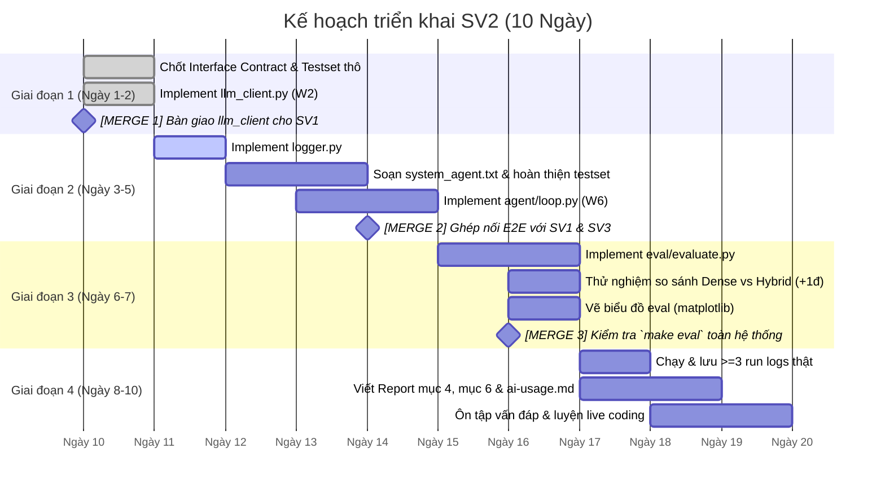

# Lộ Trình & Kế Hoạch Tiến Độ — SV2 (Agent Loop + Evaluation)

> **Môn:** AI Programming with Python (AIPR) — Final Project (10 ngày)  
> **Đề tài:** T4 — Trợ lý Điểm Rèn Luyện & Khiếu Nại  
> **Phân công SV2:** Agent Loop (W6), Evaluation (W5), LLM Client (W2), Logging, Testset, System Prompt.

---

## 1. Tổng quan các mốc thời gian (Timeline 10 Ngày)

---

## 2. Chi tiết từng giai đoạn & Điều kiện hoàn thành file

### 🔹 Giai đoạn 1: Chuẩn bị Nền tảng & Cổng LLM Client (Ngày 1 – Ngày 2)

| File SV2 sở hữu | Tài liệu mẫu & Code mẫu liên quan | Deadline | Tiêu chí hoàn thành (DoD) | Trạng thái |
|---|---|---|---|---|
| `src/aipr_project/common/llm_client.py` | - [`../w2/api_helpers.py`](file:///E:/File/APWP/aipr/w2/api_helpers.py) (cấu trúc gọi API, bảng giá token `PRICING`, `estimate_cost`) - [`../w2/test_api.py`](file:///E:/File/APWP/aipr/w2/test_api.py) (kiểm tra kết nối và response schema) | **Ngày 1** | - Cấu hình được API (Groq `openai/gpt-oss-20b`, Jina `jina-embeddings-v3`). - Hàm `chat()` có retry backoff khi 429/5xx/mạng, ngắt khi 400/401/403/404. - In log lỗi HTTP ra `sys.stderr` (không in `stdout`). - Hàm `embed(texts)` trả về `list[list[float]]` cho SV1 dùng. - Đã test toàn diện 5 hàm và kiểm tra file log. | **Hoàn thành (Done)** |
| `tests/testset.jsonl` (Draft) | - [`context/interface-contract.md`](file:///E:/File/APWP/aipr/aipr-project/context/interface-contract.md) (Mục 3: schema chuẩn JSONL) - [`data/source_docs/quy_dinh_diem_ren_luyen.md`](file:///E:/File/APWP/aipr/aipr-project/data/source_docs/quy_dinh_diem_ren_luyen.md) (DOC0001: Điều 4–9) - [`data/source_docs/so_tay_sinh_vien.md`](file:///E:/File/APWP/aipr/aipr-project/data/source_docs/so_tay_sinh_vien.md) (Quy định khiếu nại) | **Cuối Ngày 2** | - Dự thảo khung 12 câu (3 direct, 2 synthesis, 2 calc, 1 action, 4 no_answer). | Đang làm |
| `context/interface-contract.md` | - [`context/assigment/sv2.md`](file:///E:/File/APWP/aipr/aipr-project/context/assigment/sv2.md) - [`context/category-mapping.md`](file:///E:/File/APWP/aipr/aipr-project/context/category-mapping.md) | **Ngày 1** | - Đã chốt định dạng log 5 `step_type`, tên 5 tools, và bổ sung hợp đồng interface Python nội bộ giữa SV1, SV2, SV3. | **Hoàn thành (Done)** |

🤝 **Điểm Merge & Bàn Giao #1 (Hoàn thành trong Ngày 1):**
- **Bàn giao:** Đã hoàn thành và kiểm thử `src/aipr_project/common/llm_client.py`, commit lên Git để **SV1 kéo về dùng** trong `rag/store.py` (`embed_all`).
- **Nhận từ nhóm:** SV1 xác nhận câu từ chối chuẩn fallback (`"Không tìm thấy nội dung liên quan trong tài liệu."`). SV3 xác nhận signature `mcp_client.py`.

---

### 🔹 Giai đoạn 2: Xây dựng Agent Loop, Logging & Prompts (Ngày 3 – Ngày 5)

| File SV2 sở hữu | Tài liệu mẫu & Code mẫu liên quan | Deadline | Tiêu chí hoàn thành (DoD) |
|---|---|---|---|
| `src/aipr_project/agent/logger.py` | - [`context/interface-contract.md`](file:///E:/File/APWP/aipr/aipr-project/context/interface-contract.md) (Mục 1: format log JSONL chuẩn) - [`../w2/api_helpers.py`](file:///E:/File/APWP/aipr/w2/api_helpers.py) (hàm `log_api_call` mẫu) | **Ngày 3** | - Hàm `log_step()` append đúng 1 dòng JSON vào `logs/run_<timestamp>.jsonl`. - Tự sinh timestamp UTC. - Ghi đủ 5 `step_type`, field `usage` chỉ điền khi `llm_call`. |
| `prompts/system_agent.txt` | - [`data/source_docs/quy_dinh_diem_ren_luyen.md`](file:///E:/File/APWP/aipr/aipr-project/data/source_docs/quy_dinh_diem_ren_luyen.md) (nội dung quy chế rèn luyện) - [`prompts/grounding_rag.txt`](file:///E:/File/APWP/aipr/aipr-project/prompts/grounding_rag.txt) (quy tắc trích nguồn và fallback của SV1) | **Ngày 4** | - Định nghĩa rõ vai trò của trợ lý rèn luyện. - Quy tắc: Khiếu nại $\rightarrow$ gọi `submit_appeal` rồi **bắt buộc** gọi ngay `get_appeal_status`. - Khớp 100% tên tool của SV3 (`mcp_server/server.py`). |
| `src/aipr_project/agent/loop.py` | - [`../w6/ex1_2_ag_loop.py`](file:///E:/File/APWP/aipr/w6/ex1_2_ag_loop.py) (khung Agent Loop mẫu) - [`../w6/ex2_1_react_0_unfinished.py`](file:///E:/File/APWP/aipr/w6/ex2_1_react_0_unfinished.py) (ReAct loop) - [`../w7/ex1_2_mcp_client.py`](file:///E:/File/APWP/aipr/w7/ex1_2_mcp_client.py) (mẫu client gọi `list_tools` & `call_tool`) | **Ngày 5** | - Nhận tool schema động từ `mcp_client.discover()` (không hardcode registry). - Parse JSON arguments an toàn bằng `try/except`; nếu lỗi trả `"Error:..."` vào observation. - Chặn trần `MAX_STEPS = 6`, nếu vượt báo thông báo rõ ràng. - Ghi log qua `logger.log_step()` ở từng bước. |

🤝 **Điểm Merge & Bàn Giao #2 (Cuối Ngày 5 - Tích hợp toàn hệ thống):**
- **Điều kiện merge:** SV1 đã xong RAG + Scoring; SV3 đã xong MCP Server & MCP Client.
- **Hành động:** Merge nhánh của SV1, SV2, SV3 vào nhánh chính.
- **Kiểm thử tích hợp (Smoke Test):** Chạy `python src/aipr_project/main.py`:
  1. Hỏi 1 câu quy chế $\rightarrow$ trace gọi `search_regulations`.
  2. Yêu cầu tính điểm $\rightarrow$ trace gọi `calculate_conduct_score`.
  3. Khiếu nại $\rightarrow$ trace xuất hiện cặp `submit_appeal` $\rightarrow$ `get_appeal_status`.
  4. Kiểm tra file `logs/run_<timestamp>.jsonl` sinh ra đúng chuẩn.

---

### 🔹 Giai đoạn 3: Module Đo Lường (Evaluation) & Thử Nghiệm (+1đ) (Ngày 6 – Ngày 7)

| File SV2 sở hữu | Tài liệu mẫu & Code mẫu liên quan | Deadline | Tiêu chí hoàn thành (DoD) |
|---|---|---|---|
| `tests/testset.jsonl` (Final) | - [`data/source_docs/quy_dinh_diem_ren_luyen.md`](file:///E:/File/APWP/aipr/aipr-project/data/source_docs/quy_dinh_diem_ren_luyen.md) (DOC0001) - [`context/category-mapping.md`](file:///E:/File/APWP/aipr/aipr-project/context/category-mapping.md) (ánh xạ 5 mục tính điểm cho câu `calc`) - Tài liệu minh chứng SV mẫu (`DOC0004`) | **Đầu Ngày 6** | - Đủ $\ge 12$ câu, $\ge 4$ câu `no_answer`. - $\ge 1$ câu `calc` cố tình thiếu dữ liệu 1 mục để test nhánh lỗi của `scoring.py`. |
| `src/aipr_project/eval/evaluate.py` | - [`prompts/grounding_rag.txt`](file:///E:/File/APWP/aipr/aipr-project/prompts/grounding_rag.txt) (lấy chuỗi fallback từ chối chuẩn để regex match) - [`prompts/judge.txt`](file:///E:/File/APWP/aipr/aipr-project/prompts/) (tạo prompt mẫu LLM-as-judge) - [`context/interface-contract.md`](file:///E:/File/APWP/aipr/aipr-project/context/interface-contract.md) (quy tắc đọc usage và log) | **Ngày 7** | - Chạy agent THẬT qua từng câu trong testset. - LLM-as-judge chấm **Faithfulness** (câu thường). - String match chấm **Tỉ lệ từ chối đúng** (câu `no_answer`). - Đọc log cộng dồn token usage và chi phí theo từng câu. - Xuất file `logs/eval_report.csv` và in bảng tổng hợp ra màn hình. |
| So sánh & Biểu đồ (+1 điểm thưởng) | - [`../w4/ex2_1_hybrid_search.py`](file:///E:/File/APWP/aipr/w4/ex2_1_hybrid_search.py) (logic hybrid BM25 + dense mẫu để so sánh với dense-only) | **Cuối Ngày 7** | - Chạy đánh giá cấu hình Dense-only vs Hybrid Search. - Xuất biểu đồ cột `faithfulness_comparison.png` qua `matplotlib`. |

🤝 **Điểm Merge & Bàn Giao #3 (Cuối Ngày 7 - Kiểm tra `make eval`):**
- Đảm bảo lệnh `uv run python src/aipr_project/eval/evaluate.py` (hoặc `make eval`) chạy một mạch từ đầu đến cuối không bị crash.
- Mọi thành viên trong nhóm đều chạy được `make eval` trên máy cá nhân mà không cần chỉnh sửa đường dẫn tuyệt đối thủ công.

---

### 🔹 Giai đoạn 4: Thu Thập Dữ Liệu Thực Nghiệm & Hoàn Thiện Báo Cáo (Ngày 8 – Ngày 10)

| Công việc | Tài liệu mẫu & Tham khảo liên quan | Deadline | Tiêu chí hoàn thành (DoD) |
|---|---|---|---|
| Lưu $\ge 3$ logs chạy thật | - Mẫu trace mục 1 trong [`context/interface-contract.md`](file:///E:/File/APWP/aipr/aipr-project/context/interface-contract.md) | **Ngày 8** | `logs/run_<timestamp>.jsonl` của 3 lần chạy thật khác nhau, không ghi đè. |
| Viết Báo Cáo Word (`report.docx`) | - Khung báo cáo tại Mục 9 [`README.md`](file:///E:/File/APWP/aipr/aipr-project/README.md) - File mẫu [`../w4/report.docx`](file:///E:/File/APWP/aipr/w4/report.docx) (tham khảo format trình bày) | **Ngày 9** | - **Mục 4:** Thiết kế Agent loop, schema dataclass, `MAX_STEPS`, xử lý lỗi an toàn, trace 1 câu thực tế. - **Mục 6:** Bảng kết quả eval, tỉ lệ từ chối, chi phí token/câu, biểu đồ so sánh, phân tích ít nhất 1 ca lỗi thật. |
| Cập nhật `ai-usage.md` | - File [`ai-usage.md`](file:///E:/File/APWP/aipr/aipr-project/ai-usage.md) | **Ngày 9** | Khai báo chi tiết công cụ, prompt sử dụng cho các file do SV2 viết. |
| Luyện tập bảo vệ & Live Coding | - Mục 5 & 6 trong file này (Checklist & Kịch bản live coding) | **Ngày 10** | Trả lời trôi chảy 5 câu hỏi vấn đáp cốt lõi và làm chủ toàn bộ code của mình. |

---

## 3. Bảng Ánh Xạ File SV2 ↔ File Tài Liệu Mẫu & Code Mẫu Tham Khảo

Bảng tra cứu nhanh giúp SV2 biết chính xác cần mở file tài liệu hay lab mẫu nào khi đang code:

| File của SV2 | Nhóm tài liệu | File tài liệu / Code mẫu cụ thể | Mục đích sử dụng |
|---|---|---|---|
| **`common/llm_client.py`** | Lab mẫu W2 | [`../w2/api_helpers.py`](file:///E:/File/APWP/aipr/w2/api_helpers.py) | Tham khảo bảng giá token `PRICING`, logic tính `estimate_cost()`, và cấu trúc gọi API qua client. |
| | Lab mẫu W2 | [`../w2/test_api.py`](file:///E:/File/APWP/aipr/w2/test_api.py) | Tham khảo cách bắt lỗi HTTP status, xử lý timeout và retry backoff. |
| **`agent/logger.py`** | Spec / Contract | [`context/interface-contract.md`](file:///E:/File/APWP/aipr/aipr-project/context/interface-contract.md) (Mục 1) | Chuẩn hóa 100% format JSONL: tên các field (`run_id`, `question_id`, `step_index`, `timestamp`, `step_type`, `usage`), 5 giá trị `step_type`. |
| | Lab mẫu W2 | [`../w2/api_helpers.py`](file:///E:/File/APWP/aipr/w2/api_helpers.py) | Tham khảo cách mở file append `json.dumps(log_entry) + "\n"`. |
| **`agent/loop.py`** | Lab mẫu W6 | [`../w6/ex1_2_ag_loop.py`](file:///E:/File/APWP/aipr/w6/ex1_2_ag_loop.py) | Tái dùng mẫu cấu trúc Agent Loop cơ bản (vòng lặp gọi LLM $\rightarrow$ phát hiện tool call $\rightarrow$ gọi tool $\rightarrow$ cập nhật history). |
| | Lab mẫu W6 | [`../w6/ex2_1_react_0_unfinished.py`](file:///E:/File/APWP/aipr/w6/ex2_1_react_0_unfinished.py) | Tham khảo logic ReAct pattern và cơ chế chặn lặp an toàn `MAX_STEPS`. |
| | Lab mẫu W7 | [`../w7/ex1_2_mcp_client.py`](file:///E:/File/APWP/aipr/w7/ex1_2_mcp_client.py) | Xem cách client MCP gọi `list_tools()` để lấy input_schema và gọi `call_tool()` qua stdio. |
| **`prompts/system_agent.txt`** | Corpus tài liệu | [`data/source_docs/quy_dinh_diem_ren_luyen.md`](file:///E:/File/APWP/aipr/aipr-project/data/source_docs/quy_dinh_diem_ren_luyen.md) | Nắm tên các tiêu chí điểm để mô tả ngữ cảnh hướng dẫn agent chọn tool. |
| | Prompt mẫu của SV1 | [`prompts/grounding_rag.txt`](file:///E:/File/APWP/aipr/aipr-project/prompts/grounding_rag.txt) | Đảm bảo phong cách prompt đồng nhất và ăn khớp luật từ chối trả lời ngoài corpus. |
| **`tests/testset.jsonl`** | Corpus tài liệu | [`data/source_docs/quy_dinh_diem_ren_luyen.md`](file:///E:/File/APWP/aipr/aipr-project/data/source_docs/quy_dinh_diem_ren_luyen.md) | Soạn câu hỏi direct/synthesis cho Điều 4, 5, 6, 7, 8, 9 và phụ lục 1. |
| | Corpus tài liệu | [`data/source_docs/so_tay_sinh_vien.md`](file:///E:/File/APWP/aipr/aipr-project/data/source_docs/so_tay_sinh_vien.md) | Soạn câu hỏi về thủ tục, thời hạn và quy trình khiếu nại. |
| | Spec nghiệp vụ | [`context/category-mapping.md`](file:///E:/File/APWP/aipr/aipr-project/context/category-mapping.md) | Chuẩn hóa 5 key điểm rèn luyện khi soạn câu hỏi tính điểm (`type: calc`). |
| **`eval/evaluate.py`** | Spec / Contract | [`context/interface-contract.md`](file:///E:/File/APWP/aipr/aipr-project/context/interface-contract.md) (Mục 1, 2) | Lấy format chuỗi từ chối chuẩn (`"Không tìm thấy nội dung liên quan..."`) để tính Refusal Rate. |
| | Lab mẫu W4 | [`../w4/ex2_1_hybrid_search.py`](file:///E:/File/APWP/aipr/w4/ex2_1_hybrid_search.py) | Tham khảo cấu hình BM25 + Dense để chạy so sánh benchmark với Dense-only (+1 điểm thưởng). |
| | Báo cáo mẫu | [`../w4/report.docx`](file:///E:/File/APWP/aipr/w4/report.docx) | Tham khảo cấu trúc bảng biểu, đồ thị đánh giá để đưa vào Báo cáo cuối kỳ. |

---

## 4. Checklist Tự Kiểm Tra Kỹ Thuật Dành Cho SV2

Trước khi xác nhận hoàn thành mã nguồn, chạy kiểm tra các mục sau:

- [ ] `grep -rn "TOOL_REGISTRY" src/aipr_project/agent/` $\rightarrow$ Không có kết quả nào (chứng minh client discover động).
- [ ] Giả lập LLM sinh JSON hỏng (bỏ bớt dấu `}`) $\rightarrow$ Agent không crash, ghi log `"Error:..."` và tiếp tục.
- [ ] Chạy câu hỏi lặp $\rightarrow$ `MAX_STEPS = 6` ngắt đúng lúc, không treo vô tận.
- [ ] Mỗi dòng `step_type == "llm_call"` trong log có `usage` đủ 3 trường (`calls`, `prompt_tokens`, `completion_tokens`); các step khác `usage: null`.
- [ ] `logs/run_*.jsonl` sinh file mới cho mỗi phiên chạy, không ghi đè file cũ.
- [ ] Chạy `make eval` thành công và xuất đủ file CSV.
- [ ] `llm_client.py` retry khi gặp 429, ngắt ngay khi gặp 401/403.
- [ ] Không có lệnh `print()` tùy tiện ra `stdout` trong các module xử lý nội bộ.

---

## 5. Kịch Bản Sửa Code Tại Chỗ (Live Coding) Giảng Viên Có Thể Yêu Cầu

1. **"Hãy sửa `MAX_STEPS` thành 3 và chạy lại một câu hỏi dài xem agent phản ứng thế nào?"**  
   $\rightarrow$ Vị trí: Biến `max_steps` trong `src/aipr_project/agent/loop.py`.
2. **"Hãy đổi prompt LLM-as-judge để yêu cầu giải thích lý do trước khi cho điểm 0/1."**  
   $\rightarrow$ Vị trí: Prompt file trong `prompts/judge.txt` hoặc hàm chấm trong `src/aipr_project/eval/evaluate.py`.
3. **"Nếu API gặp lỗi mạng 500, bạn điều chỉnh số lần retry và thời gian chờ ở đâu?"**  
   $\rightarrow$ Vị trí: `max_retries`, `backoff_factor` trong `src/aipr_project/common/llm_client.py`.
